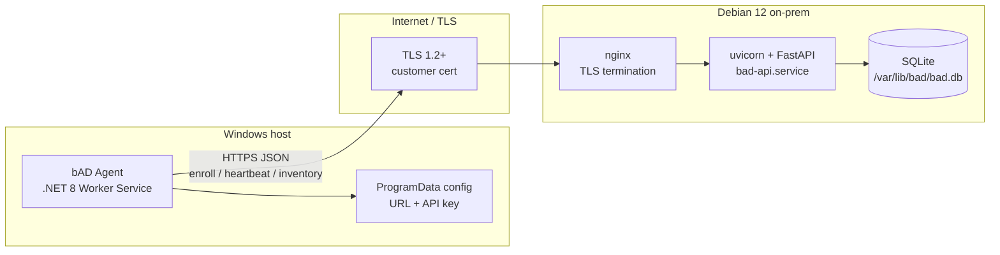

# bAD — Architecture & Implementation Plan

**blazerity Asset Discovery** — лёгкий Windows-агент инвентаризации и on-prem сервер накопления снимков.

Документ фиксирует принятые решения v1 и даёт исполнимый план для небольшой команды / solo + agents. Код не описывается как уже существующий: это greenfield-монорепозиторий.

---

## 1. Цель и границы v1

### Что поставляем

- **Windows-клиент** (MSI → `Program Files`): .NET 8 Worker Service как Windows Service; собирает hardware, OS, сеть, hostname/domain, контекст пользователя; отправляет JSON-снимки по HTTPS на настроенный URL сервера.
- **Сервер** (Debian 12, one-line install): FastAPI + SQLite за nginx с TLS на клиентских сертификатах; enrollment → API key; upsert по стабильному `device_id`; минимальный admin read API (list/get).
- **Операторский путь**: задать server URL + enrollment token при установке MSI (public properties) или в файле под `ProgramData`; на сервере — домен + пути к cert/key при установке.

### Явно вне scope v1

- Агенты macOS/Linux, мобильные устройства.
- Полноценный product dashboard (графики, поиск, роли). В MVP обязателен простой read-only веб-просмотр парка устройств.
- Автоматический выпуск сертификатов (Let’s Encrypt) как основной путь.
- Сканирование сети, remote discovery, agentless WMI с сервера.
- Software inventory (установленные программы), патч-статус, vulnerability scoring.
- RBAC, SSO, multi-tenant SaaS, репликация SQLite, HA-кластер.
- Push-команды на агент, remote shell, file transfer.
- AD/LDAP-интеграция для авторизации оператора.

---

## 2. Аналоги и практики

Ориентиры по *поведению*, не по стеку: Lansweeper / GLPI Agents, osquery + Fleet.

**Берём паттерны:**

| Паттерн | Как применяем в bAD |
|--------|---------------------|
| Enrollment | Один site-level enrollment token → обмен на per-agent API key |
| Heartbeat | Лёгкий ping с версией агента и статусом; отдельно от полного inventory |
| Idempotent upsert | Стабильный `device_id` (MachineGuid / hardware UUID); повторная отправка безопасна |
| Least privilege | TLS везде; секреты не в MSI payload; сервис с минимально достаточными правами |
| Thin agent | Только collect → POST; бизнес-логика и хранение на сервере |

**Не копируем:** тяжёлые enterprise-платформы, плагинные экосистемы, облачный control plane, agent plugin marketplace.

---

## 3. Архитектура



### Компоненты

| Компонент | Роль |
|-----------|------|
| **Agent** | Расписание, collectors (WMI/CIM + .NET), auth storage, HTTPS client |
| **MSI (WiX)** | Установка в Program Files, регистрация службы, public properties для URL/token |
| **nginx** | TLS, reverse proxy на `127.0.0.1:8000`, rate-limit basics, HSTS |
| **FastAPI** | `/v1/enroll`, `/v1/heartbeat`, `/v1/inventory`, admin `/v1/devices` |
| **SQLite** | Единый файл БД под пользователем `bad`; WAL mode |
| **deploy script** | Пакеты, user, systemd, nginx, firewall, cert wiring |

---

## 4. Агент (Windows)

### Stack (зафиксировано)

.NET 8 Worker Service → Windows Service; WiX MSI; тонкий агент без UI в v1.

### Жизненный цикл службы

1. Install MSI → файлы в `%ProgramFiles%\blazerity\bAD\`, служба `BlazerityAssetDiscovery`.
2. Start: загрузка config из `%ProgramData%\blazerity\bAD\config.json`.
3. Если есть enrollment token и нет API key → `POST /v1/enroll` → сохранить `api_key`, очистить/затереть enrollment token в config после успеха.
4. Startup inventory (полный снимок) → далее heartbeat каждые **15 минут**, полный inventory каждые **6 часов** (и при старте службы).
5. Stop/Pause: корректная отмена `CancellationToken`, без обрыва mid-write в config (atomic replace файла).

### Collectors (v1)

Источник: **WMI/CIM** через `Microsoft.Management.Infrastructure` / ManagementObjectSearcher; дополнение — .NET (`Environment`, `Dns`, registry MachineGuid).

| Область | Поля (минимум) |
|---------|----------------|
| Identity | `device_id` (MachineGuid `HKLM\SOFTWARE\Microsoft\Cryptography\MachineGuid`, fallback SMBIOS UUID), hostname, domain/workgroup |
| OS | Caption, Version, Build, Architecture, InstallDate |
| CPU | Name, cores, logical processors |
| RAM | Total physical bytes |
| Disks | Model, size, media type (где доступно); volumes: letter, size, free |
| NICs | Name, MAC, IPv4/IPv6, DHCP flag |
| User | Logged-on users / last interactive user если доступно через Win32_ComputerSystem / session APIs; иначе `null` |

Сбой одного collector не валит весь снимок: поле/секция помечается `null` + ошибка в `collector_errors[]`.

### Config paths

| Путь | Назначение |
|------|------------|
| `%ProgramFiles%\blazerity\bAD\` | Бинарники, не изменяемые агентом |
| `%ProgramData%\blazerity\bAD\config.json` | `server_url`, `enrollment_token` (временно), `api_key`, `device_id` cache |
| `%ProgramData%\blazerity\bAD\logs\` | Ротация логов (Serilog file sink, 7 дней) |

Пример `config.json` после enrollment:

```json
{
  "server_url": "https://bad.example.com",
  "api_key": "bad_ak_…",
  "device_id": "…-MachineGuid-…",
  "inventory_interval_hours": 6,
  "heartbeat_interval_minutes": 15
}
```

### Privileges

- **Рекомендация v1:** служба под **LocalSystem** — простой доступ к WMI/MachineGuid/сессиям; документировать риск.
- **Цель harden-фазы:** dedicated local service account с правами на нужные WMI namespaces + чтение MachineGuid; без интерактивного logon.
- Сеть outbound только HTTPS к `server_url` (порт 443).

### MSI

- WiX: установка в Program Files, ServiceInstall/ServiceControl Start=`auto`.
- Public properties: `SERVERURL`, `ENROLLMENTTOKEN` → записываются в `ProgramData\config.json` custom action’ом при install/repair.
- Upgrade: major upgrade same UpgradeCode; сохранить `ProgramData` (API key и device_id); заменить бинарники; restart службы.
- Не вшивать secrets в MSI binary; только properties / post-install файл с ACL: Administrators + SYSTEM.

### Расписание (итог)

- Inventory: **при старте** + каждые **6 часов**.
- Heartbeat: каждые **15 минут** (лёгкий payload: agent version, uptime, last_inventory_at).
- При 4xx auth → один повтор enroll если enrollment token ещё есть; иначе log error и backoff (max 1h).

---

## 5. Сервер (Debian 12)

### Stack (зафиксировано)

Python 3.11+ · FastAPI · SQLite · uvicorn · nginx (TLS termination) · systemd · one-line `curl | sudo bash`.

### Endpoints (v1)

| Method | Path | Auth | Назначение |
|--------|------|------|------------|
| `POST` | `/v1/enroll` | Enrollment token (`Authorization: Bearer <enrollment>`) | Создать/вернуть agent API key + зарегистрировать device skeleton |
| `POST` | `/v1/heartbeat` | API key | Обновить `last_seen`, agent version |
| `POST` | `/v1/inventory` | API key | Upsert полного снимка по `device_id` |
| `GET` | `/v1/devices` | Admin token | Список устройств (кратко) |
| `GET` | `/v1/devices/{device_id}` | Admin token | Полный последний inventory + meta |
| `GET` | `/v1/health` | none | liveness для nginx/systemd |

Admin token — отдельный секрет, генерируется install-скриптом в `/etc/bad/admin.env`, не совпадает с enrollment token.

### Data model (SQLite)

```
devices
  device_id        TEXT PRIMARY KEY
  hostname         TEXT
  api_key_hash     TEXT NOT NULL      -- argon2/bcrypt hash, не plaintext
  enrolled_at      TEXT NOT NULL      -- ISO-8601 UTC
  last_seen_at     TEXT
  agent_version    TEXT
  meta_json        TEXT              -- лёгкие поля (os caption и т.п.)

inventory_snapshots
  id               INTEGER PRIMARY KEY
  device_id        TEXT NOT NULL REFERENCES devices(device_id)
  received_at      TEXT NOT NULL
  schema_version   INTEGER NOT NULL
  payload_json     TEXT NOT NULL     -- полный снимок

site_secrets
  key              TEXT PRIMARY KEY  -- 'enrollment_token_hash', …
  value            TEXT NOT NULL
```

- Путь БД: `/var/lib/bad/bad.db`, владелец `bad:bad`, mode `0600`.
- WAL + `busy_timeout=5000`.
- Upsert: `INSERT … ON CONFLICT(device_id) DO UPDATE`; новый snapshot всегда append в `inventory_snapshots`; admin API по умолчанию отдаёт последний; retention: хранить последние **30** снимков на устройство (prune в фоне раз в сутки).

### TLS и nginx

- Cert/key: пути, заданные при install (`/etc/bad/tls/fullchain.pem`, `privkey.pem` или symlink на customer paths).
- nginx слушает `443`; proxy_pass на `http://127.0.0.1:8000`; uvicorn **не** публикует 0.0.0.0 наружу.
- Только TLS 1.2+; HSTS; отказ HTTP или redirect 80→443.
- Customer приносит root/intermediate + leaf + private key; скрипт проверяет, что cert покрывает указанный domain (CN/SAN).

### One-line installer (`deploy/debian/install.sh`)

Поведение:

1. Требует root; Debian 12.
2. Ставит `python3`, `python3-venv`, `nginx`, `sqlite3`, `ufw` (если нет).
3. Создаёт system user `bad` (nologin), dirs `/opt/bad`, `/var/lib/bad`, `/etc/bad`, `/var/log/bad`.
4. Кладёт application (venv + wheel/source из того же tarball/repo snapshot, что тянет скрипт).
5. Читает env или interactive prompt: `BAD_DOMAIN`, `BAD_TLS_CERT`, `BAD_TLS_KEY`, опционально `BAD_ADMIN_EMAIL` (только для напоминания в выводе).
6. Генерирует enrollment token и admin token → `/etc/bad/site.env` (0600, root:bad).
7. Пишет nginx site + systemd `bad-api.service` (uvicorn) и включает nginx.
8. `ufw allow 22,80,443` (минимально); deny остальное по умолчанию если ufw inactive → enable осторожно с предупреждением.
9. Печатает: URL, enrollment token, admin token, путь к логам — **один раз**; токены не логировать в world-readable файлы.

Команда оператора:

```bash
curl -fsSL https://<distribution-host>/bad/install.sh | sudo bash
# или: BAD_DOMAIN=… BAD_TLS_CERT=… BAD_TLS_KEY=… sudo -E bash install.sh
```

Источник дистрибутива — артефакт релиза команды (не выдуманный git remote в этом плане); скрипт параметризуется URL пакета.

---

## 6. Безопасность

| Тема | Решение v1 |
|------|------------|
| Transport | HTTPS only; agent отклоняет cleartext `http://` |
| Enrollment | Длинный random token (≥32 bytes, url-safe); один на сайт; hash в БД; rotate = новый token + invalidate старый через admin/CLI |
| Agent API key | Выдаётся при enroll; hash в БД; plaintext только в ProgramData ACL |
| MSI | Не встраивать token в Transform по умолчанию в публичный share; передавать через secure deploy / GPO / property на момент install |
| Admin API | Отдельный Bearer admin token; не использовать enrollment token для чтения |
| Service account | LocalSystem на MVP; harden → least-privilege account |
| Rate limits | nginx `limit_req` на `/v1/enroll` (строго) и общий лимит на API |
| Internet exposure | Только 443 снаружи; API bind localhost; fail2ban optional later; нет debug endpoints |
| SQLite | Файл 0600; backups — `sqlite3 .backup` по cron под `bad` |
| Logs | Не писать API keys / enrollment tokens в access/app logs |
| Updates | MSI upgrade сохраняет ProgramData; сервер — replace `/opt/bad` + migrate schema через Alembic-lite или версионированные SQL migrations в `server/migrations/` |

---

## 7. Протокол и схема данных

- Base URL: `https://bad.example.com`
- Headers: `Authorization: Bearer <token>`, `Content-Type: application/json`, `User-Agent: bad-agent/<semver>`
- Поле **`schema_version`**: integer, сейчас **`1`**; сервер принимает известные версии, отклоняет неизвестные с `400`.

### `POST /v1/enroll`

Request:

```json
{
  "device_id": "a1b2c3d4-e5f6-7890-abcd-ef1234567890",
  "hostname": "WS-FINANCE-12",
  "agent_version": "1.0.0"
}
```

Response `200`:

```json
{
  "api_key": "bad_ak_…",
  "device_id": "a1b2c3d4-e5f6-7890-abcd-ef1234567890"
}
```

### `POST /v1/inventory` (компактный пример payload)

```json
{
  "schema_version": 1,
  "device_id": "a1b2c3d4-e5f6-7890-abcd-ef1234567890",
  "collected_at": "2026-10-15T14:55:00Z",
  "agent_version": "1.0.0",
  "host": {
    "hostname": "WS-FINANCE-12",
    "domain": "CORP",
    "os": {
      "caption": "Microsoft Windows 11 Pro",
      "version": "10.0.22631",
      "build": "22631",
      "arch": "x64"
    }
  },
  "hardware": {
    "cpu": { "name": "Intel Core i7-12700", "cores": 12, "logical": 20 },
    "ram_bytes": 34359738368,
    "disks": [{ "model": "Samsung SSD 980", "size_bytes": 512110190592 }],
    "volumes": [{ "letter": "C:", "size_bytes": 511862308864, "free_bytes": 120259084288 }]
  },
  "network": {
    "nics": [{
      "name": "Ethernet",
      "mac": "00:11:22:33:44:55",
      "ipv4": ["10.20.30.40"],
      "dhcp": true
    }]
  },
  "users": {
    "logged_on": ["CORP\\jdoe"],
    "last_interactive": "CORP\\jdoe"
  },
  "collector_errors": []
}
```

Heartbeat — отдельный маленький JSON: `device_id`, `agent_version`, `last_inventory_at`.

---

## 8. План реализации по этапам

### Phase 0 — Skeleton монорепо

**Deliverables:** структура `agent/`, `server/`, `installer/msi/`, `deploy/debian/`, `docs/`; README с build/run локально; пустой CI lint (dotnet + ruff/mypy).

### Phase 1 — Server MVP

**Deliverables:** FastAPI app с health/enroll/heartbeat/inventory/devices; SQLite schema + migrations; hash storage; uvicorn unit file; nginx sample config с TLS placeholders; ручной install на Debian 12 VM; интеграционный тест `curl` enroll → inventory → get.

### Phase 2 — Agent MVP

**Deliverables:** .NET Worker: config load, enroll, schedule, collectors (все секции v1), HTTPS client; установка как service через `sc.exe` для dev; логи в ProgramData; e2e против Phase 1 сервера.

### Phase 3 — MSI + one-line server install

**Deliverables:** WiX MSI с `SERVERURL`/`ENROLLMENTTOKEN`; major upgrade; `deploy/debian/install.sh` end-to-end (пакеты, user, systemd, nginx, ufw, token generation); документ оператора «установил сервер → MSI на 1 ПК → устройство в `GET /v1/devices`».

### Phase 4 — Harden

**Deliverables:** rate limits; prune snapshots; ACL на config; отказ http; ротация enrollment; опциональный least-privilege service account; backup cron script; structured logging без секретов.

### Phase 5 — Web view (входит в MVP)

**Deliverables:** read-only веб-страницы на том же HTTPS origin (FastAPI Jinja/static или встроенный HTML): список устройств + карточка устройства с последним inventory; доступ по admin token (cookie или Bearer через простой login form). Без редактирования активов.

Каждая фаза заканчивается чеклистом MVP-критериев (ниже) для уже готовых пунктов.

---

## 9. Критерии готовности MVP

MVP = Phase 0–3 и Phase 5 (web view) закрыты. Принять можно, когда всё ниже истинно:

- [ ] На чистой Debian 12 one-line install поднимает HTTPS API с customer cert/key и печатает enrollment + admin tokens.
- [ ] `GET /v1/health` → 200 через публичный DNS имени из cert.
- [ ] MSI ставит службу; после reboot служба running без ручного старта.
- [ ] Свойства `SERVERURL` + `ENROLLMENTTOKEN` (или config в ProgramData) достаточны для первого enroll без UI.
- [ ] Агент получает API key, сохраняет в ProgramData; повторный старт **не** требует enrollment token.
- [ ] Полный inventory уходит при старте и содержит `schema_version`, `device_id`, host/os, cpu, ram, disks/volumes, nics, users (или явный null + error).
- [ ] Повторный `POST /v1/inventory` с тем же `device_id` обновляет устройство; `GET /v1/devices/{id}` отдаёт последний payload.
- [ ] Heartbeat обновляет `last_seen_at`.
- [ ] Внешний доступ только по TLS; uvicorn не слушает публичный интерфейс.
- [ ] Upgrade MSI сохраняет API key и продолжает отправку без re-enroll.
- [ ] Нет plaintext enrollment/API key в world-readable файлах на сервере; agent config недоступен Users (ACL).
- [ ] В браузере по HTTPS открывается web view: список устройств и карточка с последним inventory; без admin token — отказ.

---

## Структура репозитория (greenfield)

```
agent/                 # C# .NET 8 Worker Service
server/                # Python FastAPI + SQLite
installer/msi/         # WiX
deploy/debian/         # install.sh, systemd units, nginx site template
docs/                  # операторские и архитектурные документы
```

Имена артефактов релиза: `bad-agent-<semver>.msi`, `bad-server-<semver>.tar.gz`, `install.sh`.

---

*Конец плана v1. Решения §«locked» не переоткрывать без явной смены scope продукта.*
