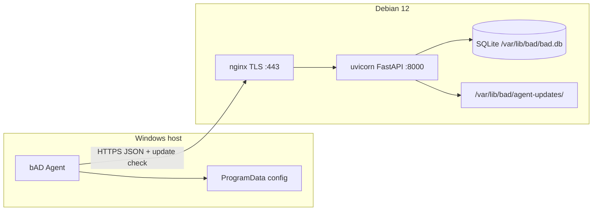
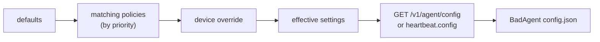

# Архитектура bAD

**blazerity Asset Discovery** — Windows-агент инвентаризации и on-prem сервер накопления снимков. Документ описывает фактическую архитектуру репозитория в согласовании с [architecture-plan.md](architecture-plan.md). Версия продукта: **0.4.0**.

## Компоненты

| Компонент | Путь | Роль |
|-----------|------|------|
| **Agent** | `agent/` | .NET 8 Worker Service (`BlazerityAssetDiscovery`): collect → enroll/heartbeat/inventory; self-update через сервер; CLI `service …` |
| **Server** | `server/` | FastAPI + SQLite: API `/v1/*`, web UI (session login + LDAP), зеркало MSI с GitHub Release, uvicorn на `127.0.0.1:8000` |
| **MSI** | `installer/msi/` | WiX: Program Files, служба, public properties `SERVERURL` / `ENROLLMENTTOKEN`; MajorUpgrade сохраняет ProgramData |
| **Deploy** | `deploy/debian/` | one-line `install.sh` для Debian 12: venv, systemd, nginx TLS, ufw, `agent-updates/` |
| **GitHub Release** | `.github/workflows/release-msi.yml` | Источник `bad-agent-<ver>.msi` + `agent-release.json`; агенты к GitHub **не** ходят |



## Клиент (агент)

- Установка: MSI → `%ProgramFiles%\blazerity\bAD\`, служба auto-start под LocalSystem.
- Конфиг: `%ProgramData%\blazerity\bAD\config.json` (`server_url`, `enrollment_token` временно, `api_key`, `device_id`, интервалы, `update_*`, `remote_config_version`).
- Жизненный цикл: при старте enroll (если нет API key) → check update → полный inventory → heartbeat (с подтягиванием remote config) → циклы по эффективным интервалам.
- Remote config: сервер считает effective settings (defaults &lt; matching policies &lt; per-device override); агент применяет только safe knobs, сохраняет в `config.json`. Секреты / `server_url` / `device_id` с сервера не принимаются.
- `device_id`: MachineGuid (registry), fallback SMBIOS UUID.
- Collectors: WMI/CIM + .NET (+ Uninstall registry для software); сбой секции → `null` + запись в `collector_errors[]`.
- Секции `hardware` / `users` / `software` управляются knobs `collect_*` (disabled → поле `null`/omitted, без error spam).
- HTTPS only; cleartext `http://` отклоняется (кроме явного `BAD_ALLOW_HTTP=1` для локальной разработки).
- `User-Agent: bad-agent/<semver>`; в payload поле `agent_version`.
- Heartbeat несёт лёгкий health: `last_inventory_ok` / `last_inventory_error`, `agent_uptime_seconds`, `system_drive_free_bytes` (DriveInfo, без тяжёлого WMI) → device `meta`.
- Service CLI: `BadAgent.exe service status|start|stop|restart` (elevated); без подкоманды — host службы. См. [agents.md](agents.md).

## Удалённые настройки агента



- SQLite: `agent_policies` (name, priority, conditions JSON, settings JSON), `device_config_overrides` (per `device_id`).
- Условия: `hostname` / `domain` / `os_caption` × `equals` / `contains` (AND внутри политики).
- Safe knobs: `inventory_interval_hours`, `heartbeat_interval_minutes`, `update_check_interval_hours`, `update_enabled`, `collect_hardware` (default true), `collect_users` (default true), `collect_software` (default false, opt-in).
- Software inventory (когда `collect_software`): лёгкий список name/version/publisher из Uninstall registry (64+32), cap 500.
- Web: `/settings/policies`; на странице устройства — effective + manual override.

## Поток обновления агента


1. **GitHub → MSI** — workflow `release-msi.yml` на тег `v*` / `workflow_dispatch`: `dotnet publish` win-x64 self-contained → WiX v5 (`dotnet tool wix`) → upload MSI + `agent-release.json` (`version`, `msi_name`, `sha256`). Linux CI MSI **не** собирает.
2. **Server mirrors** — `BAD_GITHUB_REPO` (default `blazerity/bAD`), опционально `BAD_GITHUB_TOKEN`, интервал sync. Job / `POST /v1/admin/agent-update/sync` кладёт файлы в `BAD_AGENT_UPDATES_DIR` и метаданные в SQLite.
3. **Agent applies** — check на старте и по расписанию → download → verify sha256 → `msiexec /i … /qn` → выход процесса; WiX `ServiceControl` / MajorUpgrade останавливает службу, меняет файлы, стартует снова. ProgramData сохраняется. Токены не логируются.

## Сервер

### API (`/v1`)

| Method | Path | Auth | Назначение |
|--------|------|------|------------|
| `GET` | `/v1/health` | нет | liveness + `version` |
| `POST` | `/v1/enroll` | enrollment Bearer | обмен на per-agent API key |
| `POST` | `/v1/heartbeat` | API key | `last_seen` + optional health → meta; piggyback `config` если `config_version` устарел |
| `POST` | `/v1/inventory` | API key | upsert снимка по `device_id` (host/network + optional hardware/users/software) |
| `GET` | `/v1/agent/config` | API key | effective settings только для своего устройства |
| `GET` | `/v1/devices` | admin Bearer | список устройств |
| `GET` | `/v1/devices/{device_id}` | admin Bearer | meta + последний inventory |
| `GET` | `/v1/agent/update/check` | API key | `{update_available, version, sha256, url}` |
| `GET` | `/v1/agent/update/msi` | API key | байты зеркалированного MSI |
| `GET` | `/v1/admin/agent-update` | admin | статус зеркала |
| `POST` | `/v1/admin/agent-update/sync` | admin | sync с GitHub сейчас |
| `GET/POST/PUT/DELETE` | `/v1/admin/policies*` | admin | CRUD условных политик |
| `GET` | `/v1/admin/devices/{id}/config` | admin | effective + override + matched |
| `PUT/DELETE` | `/v1/admin/devices/{id}/config-override` | admin | ручной override |

- `schema_version` inventory: сервер принимает `1` и `2` (v2 добавляет optional `software`); неизвестные → `400`.
- Секреты сайта: enrollment и admin tokens (разные); в БД хранятся hash (argon2).
- Rate limit на `/v1/enroll` (sliding window).
- Retention: последние 30 снимков на устройство.

### TLS и nginx

- nginx слушает 443, TLS 1.2+, HSTS; proxy на `http://127.0.0.1:8000`.
- uvicorn не публикует внешний интерфейс.
- Cert/key: пути при install → symlink в `/etc/bad/tls/`.

### Web UI и аутентификация

| Path | Назначение |
|------|------------|
| `/login` | username/password (local, затем LDAP если включён) |
| `/logout` | сброс cookie сессии |
| `/devices`, `/devices/{id}` | просмотр inventory; admin может задать config override |
| `/settings/policies` | CRUD условных политик remote config (admin) |
| `/settings/ldap` | CRUD LDAP + Test connection; только role `admin` |
| `/account/password` | смена пароля локального пользователя |

**Локальные пользователи**

- Таблица `local_users`; пароли — argon2.
- Первый boot / пустая таблица: создаётся `admin` / `admin` с флагом `must_change_password` (баннер + редирект на смену пароля).
- Работает **без** настроенного LDAP.

**LDAP (опционально)**

- Настройки в `ldap_settings` (одна строка): host, port, use_ssl / start_tls, bind DN, encrypted bind password, search base, filter template (`{username}`), display name attr, default role.
- Bind password шифруется Fernet-ключом из `site_secrets.data_key`; в форме после save — placeholder «unchanged», plaintext не отдаётся.
- Логин: сначала local match; иначе, если LDAP enabled — search + user bind через `ldap3`.
- Роль LDAP-пользователей: `operator` (devices) или `admin` (включая LDAP settings) — поле default role.

**Сессия**

- Подписанный cookie `bad_session` (itsdangerous, 12h); секрет из `BAD_SESSION_SECRET` или `site_secrets.session_secret`.

- На `/devices` дополнительно показывается mirrored agent MSI version (из `agent_update`).


### Данные

- SQLite: `/var/lib/bad/bad.db` (prod), владелец `bad:bad`, WAL.
- Таблицы: `devices`, `inventory_snapshots`, `site_secrets`, `local_users`, `ldap_settings`, `agent_update` (singleton зеркала).
- Каталог MSI: `/var/lib/bad/agent-updates/` (конфиг).

## Enrollment и inventory

1. Оператор задаёт site enrollment token (install script → `/etc/bad/site.env`).
2. MSI/config передаёт `SERVERURL` + `ENROLLMENTTOKEN`.
3. Агент `POST /v1/enroll` → получает `api_key`, сохраняет в ProgramData, затирает enrollment token.
4. Повторные запуски используют API key; upsert по стабильному `device_id`.

## Deploy

```bash
BAD_DOMAIN=… BAD_TLS_CERT=… BAD_TLS_KEY=… sudo -E bash deploy/debian/install.sh
```

Скрипт: пакеты, user `bad`, `/opt/bad` + venv, `bad-api.service`, nginx site, ufw 22/80/443, `agent-updates/`, печать enrollment/admin tokens один раз. Web UI: `admin`/`admin` (сменить сразу); admin Bearer — для API. В `site.env` также `BAD_GITHUB_REPO` и параметры sync.

Артефакты релиза агента: `bad-agent-<semver>.msi`, `agent-release.json` (через GitHub Release). Как вырезать релиз: [guideline.md](guideline.md).

## Вне scope v1

macOS/Linux агенты (полноценный collect), расширенный software/патчи, RBAC/SSO, HA SQLite, push-команды на агент, Let’s Encrypt как основной путь, полноценный product dashboard. Прямой доступ агентов к GitHub — вне модели (только server mirror).
