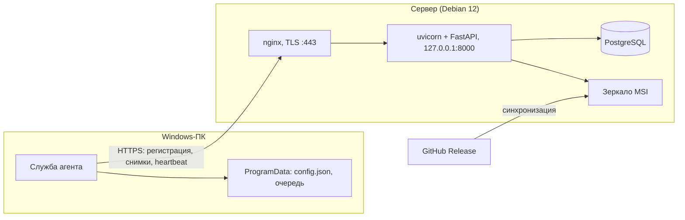
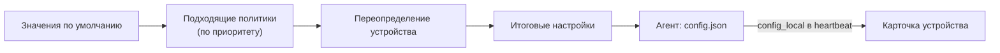
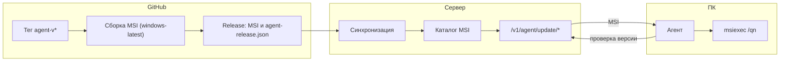

# Архитектура bAD

bAD (blazerity Asset Discovery) состоит из двух частей: агента на Windows-компьютерах и сервера в вашей сети. Агент собирает данные об оборудовании и программах, сервер хранит снимки, фиксирует изменения и показывает их в веб-панели и через API.

Версии двух частей независимы:

- **Сервер:** файл `VERSION` в корне репозитория (сейчас 2.0.1).
- **Агент:** файл `agent/VERSION` (сейчас 2.0.1).

Обновление панели с GitHub и обновление агентов на ПК — разные процедуры.

## Принципы

- **Тонкий агент.** Агент только собирает данные и отправляет их на сервер. Хранение, сравнение и политики работают на сервере.
- **Всё внутри сети.** Агенты не обращаются к GitHub. Обновления MSI они получают с вашего сервера.
- **Только HTTPS для агентов.** Незащищённый HTTP разрешён только в лаборатории, с явным флагом.
- **Устойчивость.** Сбой одного сборщика не отменяет весь снимок. Недоступность сервера не приводит к потере данных.
- **Идемпотентность.** Устройство идентифицируется стабильным `device_id`, повторная отправка безопасна.
- **Разделение секретов.** Токен регистрации, ключ агента и токен администратора — три разных секрета.

## Компоненты

| Компонент | Путь в репозитории | Назначение |
|-----------|--------------------|------------|
| Агент | `agent/` | Служба Windows на .NET 8: сбор, регистрация, отправка, обновление; CLI `bad` |
| Сервер | `server/` | Приложение FastAPI: API `/v1`, веб-панель, зеркало MSI |
| Установщик агента | `installer/msi/` | MSI на WiX: файлы, служба, параметры `SERVERURL` и `ENROLLMENTTOKEN` |
| Развёртывание | `deploy/debian/` | Скрипт установки на Debian 12, systemd-службы, шаблоны nginx |
| Релизы | `.github/workflows/` | Сборка MSI и публикация в GitHub Release |

Сервер состоит из трёх слоёв:

- **nginx** принимает HTTPS и передаёт запросы приложению. Здесь же завершается TLS.
- **uvicorn с FastAPI** обрабатывает API и веб-панель. Слушает только `127.0.0.1`.
- **PostgreSQL** хранит всё состояние. Строка подключения задаётся переменной `BAD_DATABASE_URL`.

Ключи шифрования и сессий хранятся в `/etc/bad/*`, а не в базе. Поэтому дамп базы не содержит ключей (см. «Резервные копии»).

## Агент

### Установка и службы

MSI устанавливает агент в **`%ProgramFiles%\blazerity\bad agent\`** (`bin\BadAgent.exe`, `bad.cmd`, скрипты) и регистрирует службу **`badagent`** (отображаемое имя **bAD Agent**, описание на русском). Запуск — автоматически от LocalSystem.

Апгрейд с линии **1.x**: WiX **MajorUpgrade** и скрипт **`migrate-legacy-install.ps1`** (снять службу `BlazerityAssetDiscovery`, старый каталог `...\blazerity\bAD\`, устаревший PATH). **`%ProgramData%\blazerity\bAD\`** не переносится — config и очередь сохраняются.

Конфигурация и рабочие данные лежат в `%ProgramData%\blazerity\bAD\`:

- `config.json`: адрес сервера, ключ агента, идентификатор устройства, интервалы и настройки обновления;
- `queue\`: очередь неотправленных данных;
- `logs\`: журналы агента.

Обновление MSI сохраняет `ProgramData`, поэтому повторная регистрация не нужна.

### Жизненный цикл

При старте служба выполняет шаги по порядку:

1. Регистрация на сервере, если ключа агента ещё нет.
2. Отправка данных из очереди.
3. Проверка обновления.
4. Полный снимок инвентаризации.
5. Heartbeat с подтягиванием настроек.

Дальше шаги повторяются по интервалам. По умолчанию инвентаризация выполняется раз в 6 часов, heartbeat — раз в 15 минут, проверка обновлений — раз в 24 часа.

### Идентификатор устройства

`device_id` берётся из `MachineGuid` в реестре. Если его нет, используется UUID из SMBIOS.

### Сбор данных

Сборщики используют WMI, CIM и .NET, а список программ читается из ветки Uninstall реестра (64- и 32-битная).

- Сбор идёт с пониженным приоритетом (`BelowNormal`) и с паузами между запросами WMI.
- Если подсекция не собралась, в снимке появляется запись в `collector_errors` с именем секции (например, `hardware.gpus`), а остальные данные сохраняются.
- Секции `hardware`, `users` и `software` включаются настройками `collect_*`. Выключенная секция передаётся как `null` или не передаётся вовсе.
- Секция корпуса (`hardware.chassis`) собирается всегда, даже если остальное оборудование выключено.
- Тяжёлые секции (программы, дампы, модули памяти) могут браться из кэша в памяти, если состав машины не изменился.
- **С 1.3.1:** признак «нужна перезагрузка» учитывает осмысленные операции PFRO (без ложных срабатываний на временные файлы). Для NVMe при пустом WMI-serial используется запасной идентификатор из `MSFT_PhysicalDisk.UniqueId` (префиксы `eui.` / `nguid.`).

Состав данных:

- **Система:** имя узла, домен, ОС, при вхождении в домен — OU и распределённое имя в Active Directory.
- **Оборудование:** процессор, память (объём и модули), диски и тома, видеокарты, мониторы, батарея, серийный номер, модель, производитель, тип корпуса, версия BIOS.
- **Сеть:** сетевые адаптеры, IPv4 и MAC-адреса.
- **Пользователи:** вошедшие в систему и последний интерактивный вход.
- **Программы:** название, версия и издатель (опционально, `collect_software`).
- **Дампы:** только метаданные файлов `Minidump` (имена, время, количество). Содержимое не отправляется.

Ограничения на количество элементов: 16 видеокарт, 32 модуля памяти, 8 мониторов, 20 файлов дампов, 500 программ.

### Heartbeat

Heartbeat сообщает серверу, что агент жив, и передаёт лёгкие показатели здоровья: успешность последней инвентаризации, время работы службы, свободное место на системном диске. Эти данные попадают в `meta` устройства.

Если на сервере изменились настройки, ответ heartbeat содержит их новую версию. Если у агента уже актуальная `config_version`, полный блок `config` **не** дублируется (меньше трафика, с **1.10.0**). Если оператор нажал «Обновить политику и версию», ответ содержит полный набор настроек и команды на инвентаризацию и проверку обновления.

### Очередь и отказ сервера

Если сервер недоступен, снимки и heartbeat сохраняются в `queue\` и отправляются позже с нарастающей паузой. Ограничения очереди: 64 элемента и 14 дней хранения.

Если сервер отклонил ключ агента (ответы 401 или 403), агент очищает ключ, сохраняет идентификатор устройства, пишет событие в журнал приложений Windows и больше не обращается к API, пока устройство не зарегистрируют заново или не переустановят агент.

### CLI `bad`

CLI: shim **`bad.cmd`** в каталоге установки вызывает `bin\BadAgent.exe`.

| Режим | Кто может | Что делает |
|-------|-----------|------------|
| `bad`, `bad -r` | любой пользователь | Локальный отчёт в ASCII или HTML, сервер не нужен |
| `bad -c`, `bad config set/unset` | администратор | Настройка параметров на самом ПК |
| `bad push`, `bad update` | администратор | Синхронизация с сервером и установка MSI с сервера |
| `bad service status\|start\|stop\|restart` | администратор | Управление службой `badagent` |

Параметр, заданный через CLI, помечается на сервере как «задано на агенте». Значения ключа агента и токена регистрации CLI не выводит и не задаёт.

## Сервер

### Структура приложения

Код лежит в пакете `server/bad_server/`. Основные модули:

- `api.py`: маршруты `/v1`;
- `web.py`: страницы веб-панели;
- `db.py`: работа с PostgreSQL;
- `auth.py`, `sessions.py`, `ldap_client.py`: аутентификация;
- `agent_config.py`: политики и настройки агента;
- `agent_update.py`, `github_release.py`: зеркало MSI и синхронизация с GitHub;
- `device_meta.py`: кэш полей устройства для списков;
- `panel_search.py`: глобальный поиск на Обзоре;
- `event_importance.py`: важность событий.

### Модель данных

Основные таблицы:

| Таблица | Содержимое |
|---------|-----------|
| `devices` | устройства: идентификатор, имя узла, метки, признаки отзыва и архива, `meta` |
| `inventory_snapshots` | снимки инвентаризации |
| `device_events` | события изменений и флаг отправки в почту |
| `agent_policies`, `device_config_overrides` | политики и индивидуальные переопределения настроек |
| `agent_msi_versions`, `agent_update` | каталог версий MSI и текущая версия |
| `local_users`, `ldap_settings`, `smtp_settings`, `retention_settings` | учётные записи и настройки |
| `site_secrets` | хэши токенов и служебные значения |

Поле `devices.meta` содержит кэш для списков: домен, ОС, производитель и модель, серийный номер, тип корпуса, время последнего снимка, данные heartbeat. Списки и дашборд читают кэш, а не полный снимок. Тип корпуса нормализуется в значения `laptop`, `desktop`, `server`, `vm` или `other`.

Подсказки «возможные дубликаты» на карточке сравнивают нормализованные идентификаторы: заглушки (все нули, все **F**, типовые OEM-строки) **не** считаются совпадением (с **1.10.1**). Для ускорения поиска по парку при старте создаются индексы PostgreSQL (в т.ч. `pg_trgm` для имени и `meta_json`, если расширение доступно).

### События изменений

При каждом приёме снимка сервер сравнивает его с предыдущим. Фиксируются значимые изменения: имя узла и домен, вход пользователей, добавление и удаление дисков, резкое падение свободного места, смена IP-адреса, изменение процессора, памяти, серийного номера, модели. Первый снимок событий не создаёт.

Важность события определяется по его типу, а не хранится в базе. Значения: `low`, `medium`, `high`, `critical`.

### Веб-панель

Панель работает на русском языке в стиле **Bolt** (сетки, карточки, единые отступы и поиск) и рассчитана на администраторов. Основные разделы:

| Путь | Назначение |
|------|-----------|
| `/`, `/dashboard` | сводка по парку и сигналы для оператора |
| `/devices`, `/devices/{id}` | список и карточка устройства, live-поиск, массовые действия (архив, тег), экспорт CSV |
| `/events`, `/events/{id}` | лента событий с фильтрами; отдельная страница события со ссылкой для копирования |
| `/settings/*` | параметры: LDAP, сертификат, почта, хранение, резервные копии, политики, обновления агента, обновление сервера |
| `/account/password` | смена пароля |

Страницы обзора и устройств получают сводку по парку одним запросом к базе. На **Обзоре** — поиск по парку и событиям (`GET /overview/search.json`, от двух символов, строка с кнопкой очистки). В списке устройств — `GET /devices/search.json`. Стили: `server/bad_server/static/style.css`.

Для локальных скриншотов без HTTP-bootstrap используется **`BAD_QA_UI=1`** (только lab, не production) — см. [server/README.md](../server/README.md).

Время в панели отображается относительно («5 мин. назад»), точная дата и время — в подсказке. В API и базе хранится только UTC в формате ISO 8601.

### Почтовые уведомления

Изменения, регистрация и пропажа устройств сразу записываются в `device_events`. Письма не отправляются мгновенно. Фоновый процесс примерно раз в 5 минут проверяет, прошло ли время интервала (от 1 до 48 часов, по умолчанию 3). Если да, все новые события группируются в одно письмо с HTML-версией.

Какие типы событий попадают в письмо, задаётся переключателями в настройках. События помечаются «отправленными» **только после успешной** отправки письма (с **1.10.0**). Ошибка отправки не блокирует приём данных от агентов: событие остаётся в очереди до следующей попытки.

### Хранение данных

- Количество снимков на устройство ограничено параметром `BAD_SNAPSHOT_RETENTION` (по умолчанию 30).
- Срок хранения событий (по умолчанию 90 дней) и старых снимков (по умолчанию 180 дней) задаётся в настройках.
- Фоновая очистка выполняется раз в час. Последний снимок устройства никогда не удаляется.

## Аутентификация и секреты

| Механизм | Где используется | Назначение |
|----------|------------------|-----------|
| Токен регистрации (`enrollment`) | `POST /v1/enroll` | Одноразовый обмен на ключ агента. Хранится в базе в виде хэша |
| Ключ агента | heartbeat, снимки, настройки, обновления агента | Доступ конкретного устройства. Хранится в базе в виде хэша |
| Токен администратора | `/v1/...` для администратора и интеграций | Доступ к API. Выдаётся при установке |
| Сессия в браузере | веб-панель | Cookie `bad_session`, подписана, срок 12 часов |
| LDAP | вход в панель (опционально) | Пользователи каталога AD с ограничением по группе |

Правила:

- Локальная учётная запись `admin` создаётся при первом запуске с паролем `admin` и обязательной сменой пароля. До смены панель открывает только страницу смены пароля.
- При каждом запросе панели роль локального пользователя и настройки LDAP сверяются с **БД** (с **1.10.0**), чтобы смена роли подхватывалась без обязательного повторного входа.
- Лимиты частоты входа и регистрации агентов считают **IP клиента** за nginx (`X-Real-IP` в шаблоне установки).
- Все HTML-формы защищены CSRF-токеном.
- Учётные записи LDAP проверяются сначала локально, затем через каталог. Соединение с LDAP защищено проверкой сертификата.
- Пароль LDAP и SMTP хранятся в зашифрованном виде. Ключ шифрования лежит в `/etc/bad/data_key`, вне базы.
- Ключи агентов и токены в журналах не записываются.

## Транспорт и регистрация

### Протокол

Агент и сервер обмениваются JSON по HTTPS. Заголовок `User-Agent` содержит `bad-agent/<версия>`, в данных снимка передаётся `agent_version`.

Агент отказывается работать с адресом `http://`, если не задан `BAD_ALLOW_HTTP=1` (только для лаборатории).

### Регистрация

1. Администратор задаёт токен регистрации при установке сервера или в **Параметры → Обновления агента**.
2. MSI передаёт адрес сервера и токен. Токен записывается в реестр и не попадает в аргументы PowerShell.
3. Агент отправляет `POST /v1/enroll` и получает ключ агента, который сохраняет в `ProgramData`.
4. Повторные запуски используют ключ агента. Устройства сопоставляются по `device_id`.

Смена токена регистрации действует только для новых устройств. Уже зарегистрированные агенты продолжают работать.

Когда включён TLS на сервере, регистрация по незащищённому HTTP отклоняется с ответом 403. В лаборатории это можно разрешить переменной `BAD_ALLOW_ENROLL_OVER_HTTP=1`.

## Настройки агента

Настройки агента вычисляются на сервере. Приоритеты от низшего к высшему:

1. значения по умолчанию;
2. подходящие политики (по возрастанию приоритета);
3. индивидуальное переопределение устройства.

Агент получает итоговые значения и применяет только разрешённые параметры (интервалы, включение обновлений, выбор сборщиков). Адрес сервера и секреты с сервера не принимаются.

Условия политик: имя узла, домен, ОС, метка — с операторами «равно» и «содержит». Все условия внутри политики объединяются логическим «И».

### Источник настройки

На карточке устройства для каждого параметра показывается источник:

| Источник | Значение |
|----------|----------|
| `default` | значение по умолчанию |
| `policy` | задано политикой |
| `device_override` | задано переопределением устройства |
| `agent_local` | задано локально на ПК через CLI |

Для отображения приоритет такой: `agent_local`, затем `device_override`, затем `policy`, затем `default`. Итоговое значение при этом вычисляется по порядку из раздела выше.

Агент передаёт список параметров, заданных локально, в поле `config_local` heartbeat. Сервер сохраняет его в `meta.config_local` и не записывает в переопределения. Ключи агента и токены в `config_local` не передаются.

Если нужно немедленно применить настройки, оператор нажимает «Обновить политику и версию». Сервер ставит флаг, и при следующем heartbeat агент получает полный набор настроек и команды на инвентаризацию и проверку обновления.

## Обновление агента

Агенты не обращаются к GitHub. Обновление проходит через зеркало на сервере.

1. **Сборка.** Workflow `release-msi` запускается по тегу `agent-v*` или вручную. Он публикует MSI и `agent-release.json` в GitHub Release. Версия берётся из `agent/VERSION`.
2. **Зеркало.** Сервер периодически или по запросу администратора загружает файлы из Release в каталог `BAD_AGENT_UPDATES_DIR` (в проде по умолчанию `/var/lib/bad/agent-updates`; в lab при отсутствии прав — запасной каталог в `data_dir`) и регистрирует версии в базе. Версии также можно загрузить вручную (режим air-gap).
3. **Применение.** Агент запрашивает целевую версию, скачивает MSI с сервера, проверяет SHA-256 и запускает `msiexec /i ... /qn`. Установка выполняется как обновление с понижением версии разрешено, поэтому откат тоже возможен.

Целевую версию задаёт параметр `update_target`: `latest` (последняя в зеркале) или конкретный номер версии. Защита от зацикливания: после неудачной попытки агент не повторяет её в течение 2 часов.

Проверки безопасности:

- имя файла MSI должно быть безопасным и оставаться во временном каталоге;
- ссылка на MSI должна вести на тот же сервер, что и настроенный адрес;
- контрольная сумма SHA-256 обязательна.

## Установщик MSI

- Исходники: `installer/msi/Product.wxs`, `write-config.ps1`, `cleanup-uninstall.ps1`.
- Сборка выполняется на Windows: локально или в GitHub Actions.
- Параметры установки: `SERVERURL`, `ENROLLMENTTOKEN`, `ADDPATH` (по умолчанию 1).
- **2.0+:** каталог `bad agent`, служба `badagent`; миграция с 1.x — `migrate-legacy-install.ps1`.
- Обновление MSI выполняется как major upgrade без удаления `ProgramData`.
- Полное удаление требует остановки службы и запуска `cleanup-uninstall.ps1`.
- Подпись кода необязательна: без сертификата MSI собирается без подписи.

## Сервер: развёртывание и TLS

### Установка

Скрипт `deploy/debian/install.sh` выполняет установку на Debian 12 в шесть шагов: пакеты, пользователь и каталоги, PostgreSQL, службы systemd, nginx, итоговая памятка.

Варианты настройки TLS:

- **HTTP bootstrap (основной путь).** Сертификат не передан при установке. nginx работает только по HTTP. Администратор входит в панель из доверенной сети, меняет пароль и загружает сертификат через **Параметры → Сертификат**.
- **Сертификат при установке.** Переменные `BAD_TLS_CERT` и `BAD_TLS_KEY` передают готовые файлы.

### Применение сертификата

Панель проверяет PEM и соответствие ключа сертификату, сохраняет файлы в промежуточный каталог и передаёт их systemd-службе `bad-tls-apply`. Служба копирует файлы, выполняет `nginx -t` и перезагружает nginx. При ошибке рабочие файлы не меняются.

Пути:

- `/etc/bad/tls/fullchain.pem`;
- `/etc/bad/tls/privkey.pem`;
- `/etc/bad/tls/staging/` (до применения).

После применения включаются перенаправление с HTTP на HTTPS, HSTS и флаг `Secure` для cookie (`BAD_COOKIE_SECURE=auto`).

Автоматический выпуск сертификатов (Let's Encrypt) не поддерживается.

### Обновление сервера

Страница **Параметры → Обновление сервера** загружает выбранную ветку репозитория в каталог `/var/lib/bad/server-releases/` и переключает `/opt/bad`. Установка выполняется через systemd-службу `bad-server-update-apply`. Хранятся до трёх предыдущих версий для отката. Обновление сервера не затрагивает MSI агентов.

## Резервные копии

| Артефакт | Содержимое | Назначение |
|----------|-----------|------------|
| Ежедневный дамп | `pg_dump -Fc`, файл `bad-YYYY-MM-DD.dump` | данные |
| Ключи | `/etc/bad/data_key`, `/etc/bad/session_secret` | расшифровка и сессии |
| Site bundle | дамп, ключи и метаданные зеркала | полное восстановление |

Дамп без ключей не позволяет полностью восстановить систему. Восстановление из site bundle выполняет `deploy/debian/restore-site-bundle.sh`.

## Ограничения версии 1

- Агенты только для Windows.
- Единственная СУБД — PostgreSQL на одном сервере. Высокая доступность не поддерживается.
- Нет ролевой модели и единого входа (SSO). Пользователи панели — администраторы или операторы.
- Агент не принимает команд с сервера, кроме обновления настроек и запуска инвентаризации или проверки обновления.
- Нет управления программами и патчами.

## Связанные документы

- [api-v1.md](api-v1.md): интеграционный API для внешних систем;
- [operator-guide.md](operator-guide.md): установка и эксплуатация;
- [agents.md](agents.md): карта репозитория для разработчиков;
- [guideline.md](guideline.md): правила разработки и выпуска релизов.
