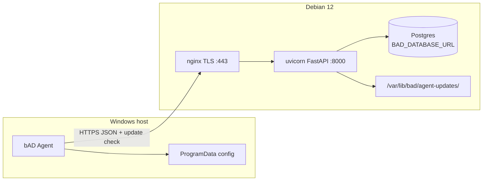
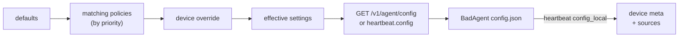
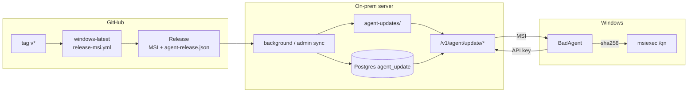

# Архитектура bAD

**blazerity Asset Discovery** — Windows-агент инвентаризации и on-prem сервер накопления снимков. Документ описывает фактическую архитектуру репозитория. Версия продукта: **1.0.1**.

- **Инвариант:** HTTP bootstrap = **только временный UI-режим** (доверенная сеть → смена пароля → upload cert → HTTPS). Агенты всегда HTTPS (кроме lab `BAD_ALLOW_HTTP=1`). Risk rating bootstrap: **Medium** при runbook; **High** на публичном `:80` до cert — не Critical defect.
- **ACME / Let’s Encrypt:** вне scope 1.0; не обещать без решения владельца.
- **Альтернатива bootstrap (оценка, не реализация в 1.0):** self-signed / внутренний CA при install → сразу HTTPS на проводе vs warning в браузере; предпочтительно install сразу с `BAD_TLS_CERT`/`BAD_TLS_KEY`.
- **Settings gate:** HTML settings (в т.ч. `/settings/tls`) не обходят `ensure_csrf` + `require_web_admin`.

## Компоненты

| Компонент | Путь | Роль |
|-----------|------|------|
| **Agent** | `agent/` | .NET 8 Worker Service (`BlazerityAssetDiscovery`): collect → enroll/heartbeat/inventory; self-update через сервер; CLI `service …` |
| **Server** | `server/` | FastAPI + **Postgres** (`BAD_DATABASE_URL`): API `/v1/*`, web UI, зеркало MSI, uvicorn `127.0.0.1:8000` |
| **MSI** | `installer/msi/` | WiX: Program Files, служба, public properties `SERVERURL` / `ENROLLMENTTOKEN`; MajorUpgrade сохраняет ProgramData; полный uninstall чистит config/queue; optional Authenticode в `release-msi` |
| **Deploy** | `deploy/debian/` | one-line `install.sh`: `[1/6]…[6/6]`, local PG, systemd, nginx, ufw, памятка |
| **GitHub Release** | `.github/workflows/release-msi.yml` | Источник `bad-agent-<ver>.msi` + `agent-release.json`; агенты к GitHub **не** ходят |



**Persistence:** только Postgres через `BAD_DATABASE_URL` (без URL API не стартует). Fresh install → local cluster (localhost). Keys (`/etc/bad/data_key`, `session_secret`) **вне** БД. HA / ACME — out of scope.

## Клиент (агент)

- Установка: MSI → `%ProgramFiles%\blazerity\bAD\`, служба auto-start под LocalSystem.
- Конфиг: `%ProgramData%\blazerity\bAD\config.json` (`server_url`, `enrollment_token` временно, `api_key`, `device_id`, интервалы, `update_*`, `remote_config_version`).
- Жизненный цикл: при старте enroll (если нет API key) → flush offline queue → check update → полный inventory → heartbeat (с подтягиванием remote config) → циклы по эффективным интервалам.
- Offline queue: при недоступном сервере inventory/heartbeat пишутся в `%ProgramData%\blazerity\bAD\queue\` и уходят с backoff (cap 64 / 14 дней); не молча теряются.
- Revoked API key (401/403): очистить `api_key`, сохранить `device_id`, запись в Application Event Log, не долбить API до re-enroll / reinstall.
- Remote config: сервер считает effective settings (defaults &lt; matching policies &lt; per-device override); агент применяет только safe knobs, сохраняет в `config.json`. Секреты / `server_url` / `device_id` с сервера не принимаются.
- `device_id`: MachineGuid (registry), fallback SMBIOS UUID.
- Collectors: WMI/CIM + .NET (+ Uninstall registry для software); сбор на `BelowNormal` + yields между WMI; сбой подсекции → `collector_errors[]` с `section` вроде `hardware.gpus` (остальной snapshot сохраняется).
- Секции `hardware` / `users` / `software` управляются knobs `collect_*` (disabled → поле `null`/omitted, без error spam).
- Hardware (когда `collect_hardware`): CPU, `ram_bytes`, disks/volumes **плюс** `serial_number`, `model`, `manufacturer`, `bios_version` (+ manufacturer/release), `battery` (charge/status/runtime), `monitors[]` (EDID/WMI, cap 8), `gpus[]` (cap 16), `ram_modules[]` (cap 32), `ram_memory_type`. Host: `ad_distinguished_name` / `ad_ou` (domain-joined, soft-fail workgroup). `minidumps` — метаданные `%SystemRoot%\Minidump\*.dmp` / `Memory.dmp` (имена/время/count, **без** тел файлов, cap 20). Поля additive внутри `schema_version=2`.
- HTTPS only; cleartext `http://` отклоняется (кроме явного `BAD_ALLOW_HTTP=1` для локальной разработки).
- `User-Agent: bad-agent/<semver>`; в payload поле `agent_version`.
- Heartbeat несёт лёгкий health: `last_inventory_ok` / `last_inventory_error`, `agent_uptime_seconds`, `system_drive_free_bytes` (DriveInfo, без тяжёлого WMI) → device `meta`; опционально `config_local` (manual keys / agent_local) — см. API notes.
- Local CLI reports (`bad` / `--html`): ASCII/HTML показывают serial/BIOS/battery/monitors/AD OU/minidumps при наличии; HTML визуально согласован с web panel (Win11/Fluent light).
- Крупные сбои enroll/update/revoke → Windows Application Event Log (source `bAD Agent`).
- Service CLI: `BadAgent.exe service status|start|stop|restart` (elevated); без подкоманды — host службы. См. [agents.md](agents.md).

## Удалённые настройки агента



- Таблицы: `agent_policies` (name, priority, conditions JSON, settings JSON), `device_config_overrides` (per `device_id`).
- Условия: `hostname` / `domain` / `os_caption` / `tag` × `equals` / `contains` (AND внутри политики).
- Safe knobs: `inventory_interval_hours`, `heartbeat_interval_minutes`, `update_check_interval_hours`, `update_enabled`, `collect_hardware` (default true), `collect_users` (default true), `collect_software` (default false, opt-in).
- Software inventory (когда `collect_software`): лёгкий список name/version/publisher из Uninstall registry (64+32), cap 500.
- Web: `/settings/policies`; на странице устройства — effective + override **и** источник knobs (`sources` / `agent_local`) — см. [API notes: config source](#api-notes-config-source-provenance).
- Теги устройства: JSON-массив `tags_json` на `devices`; правка в web / `PUT /v1/devices/{id}/tags`; фильтр списка `?tag=`.

## Поток обновления агента



1. **GitHub → MSI** — workflow `release-msi.yml` на тег `v*` / `workflow_dispatch`: `dotnet publish` win-x64 self-contained → WiX v5 (`dotnet tool wix`) → optional Authenticode (`CODE_SIGN_PFX_*`, иначе unsigned) → upload MSI + `agent-release.json` (`version`, `msi_name`, `sha256`). Linux CI MSI **не** собирает. Агент при apply: sanitize `msi_name` (SEC-002) и same-origin download URL (SEC-009).
2. **Зеркало на сервере** — `BAD_GITHUB_REPO` (default `blazerity/bAD`), опционально `BAD_GITHUB_TOKEN`, интервал sync. Job / `POST /v1/admin/agent-update/sync` кладёт файлы в `BAD_AGENT_UPDATES_DIR` и метаданные в БД.
3. **Агент применяет** — check на старте и по расписанию → follow `target_version` (вкл. downgrade) → download (same-origin) → verify sha256 → `msiexec /i … /qn` → выход; WiX `ServiceControl` / MajorUpgrade (**AllowDowngrades**). Remote knob: `update_target`. Anti-loop pending 2h. Токены не логируются.

## Сервер

### API (`/v1`)

Интеграционный гайд (1C Itilium, additive freeze): [api-v1.md](api-v1.md).

| Method | Path | Auth | Назначение |
|--------|------|------|------------|
| `GET` | `/v1/health` | нет | liveness + `version` |
| `POST` | `/v1/enroll` | enrollment Bearer | обмен на per-agent API key |
| `POST` | `/v1/heartbeat` | API key | `last_seen` + optional health + optional `config_local` → meta; piggyback `config` если `config_version` устарел |
| `POST` | `/v1/inventory` | API key | upsert снимка по `device_id` (host/network + optional hardware/users/software); diff → `device_events` |
| `GET` | `/v1/agent/config` | API key | effective settings только для своего устройства |
| `GET` | `/v1/devices` | admin Bearer | список (`?tag=&q=&archived=&page=&page_size=`) |
| `GET` | `/v1/devices/{device_id}` | admin Bearer | meta + tags + inventory + duplicates hint |
| `POST` | `/v1/devices/{id}/revoke` | admin | отозвать API key (далее 403) |
| `POST` | `/v1/devices/{id}/rotate-key` | admin | новый API key (plaintext один раз) |
| `POST` | `/v1/devices/{id}/archive` / `restore` | admin | скрыть/вернуть в списке |
| `DELETE` | `/v1/devices/{id}` | admin | hard-delete + связанные строки |
| `PUT` | `/v1/devices/{device_id}/tags` | admin Bearer | заменить теги устройства |
| `GET` | `/v1/events` | admin Bearer | события (`?device_id=&limit=&offset=`) |
| `GET` | `/v1/agent/update/check?current=` | API key | `{current, target_version, update_available, sha256, url, msi_name, reason}` |
| `GET` | `/v1/agent/update/msi` | API key | байты зеркалированного MSI |
| `GET` | `/v1/admin/agent-update` | admin | статус зеркала |
| `POST` | `/v1/admin/agent-update/sync` | admin | sync с GitHub сейчас |
| `GET/POST/PUT/DELETE` | `/v1/admin/policies*` | admin | CRUD условных политик |
| `GET` | `/v1/admin/devices/{id}/config` | admin | effective + override + matched + `sources` / `agent_local_keys` |
| `PUT/DELETE` | `/v1/admin/devices/{id}/config-override` | admin | ручной override |
| `POST` | `/v1/admin/enrollment/rotate` | admin Bearer | новый site enrollment token (plaintext в ответе **один раз**) |

- `schema_version` inventory: сервер принимает `1` и `2` (v2 добавляет optional `software`; hardware fields вроде `serial_number`/`gpus`/`ram_modules` — additive, без bump schema); неизвестные → `400`.
- Секреты сайта: enrollment и admin tokens (разные); в БД хранятся hash (argon2).
- Rate limit на `/v1/enroll` (sliding window).
- Count-retention: последние N снимков на устройство (`BAD_SNAPSHOT_RETENTION`, default 30).
- Day-retention (web): `retention_settings` — events (default 90d) и old snapshots (default 180d); фоновый prune раз в час; новейший снимок устройства не удаляется.

#### API notes: config source (provenance)

**Зачем.** На карточке устройства в web UI нужно отличать knobs, которые **прописаны руками на агенте** (CLI / правка `config.json`), от site default, политики и server `device_override`.

**Enum `source` (на ключ safe knob):**

| Значение | Смысл |
|----------|--------|
| `default` | значение из `DEFAULT_AGENT_SETTINGS`, не перекрыто политикой/override и не agent_local |
| `policy` | последнее совпавшее policy settings выставило ключ; нет device_override и не agent_local |
| `device_override` | ключ есть в server `device_config_overrides`; не agent_local |
| `agent_local` | агент сообщил, что ключ задан локально (руками); **побеждает** для UI provenance |

Порядок для UI-метки (не меняет remote effective merge `defaults < policy < device_override`):  
`agent_local` > `device_override` > `policy` > `default`.

**Schema notes — inbound heartbeat** (`POST /v1/heartbeat`, additive / optional):

```json
{
  "device_id": "…",
  "config_version": "…",
  "config_local": {
    "keys": ["inventory_interval_hours", "collect_software"],
    "settings": {
      "inventory_interval_hours": 3,
      "collect_software": true
    },
    "server_url": "https://bad.example.com"
  }
}
```

| Поле | Тип | Правила |
|------|-----|---------|
| `config_local` | object \| omit | отсутствует / `null` → не трогать сохранённый meta-снимок; пустой объект / `keys: []` → сбросить agent_local |
| `config_local.keys` | `string[]` | только `ALLOWED_SETTING_KEYS`; неизвестные отбросить; max ≤ числа safe knobs; **источник истины** списка manual keys |
| `config_local.settings` | object | опционально: значения для ключей из `keys` (sanitize как remote settings); для UI «что стоит на агенте» |
| `config_local.server_url` | string | опционально, **display-only** (не safe knob, не remote merge); max length как у URL в агенте; не логировать как секрет |

`api_key` / `enrollment_token` в `config_local` **запрещены** (игнор / strip).

**Schema notes — хранение (Server Lead):** в `devices.meta_json`:

```json
{
  "config_local": {
    "keys": ["inventory_interval_hours"],
    "settings": { "inventory_interval_hours": 3 },
    "server_url": "https://bad.example.com",
    "reported_at": "2026-10-16T12:00:00Z"
  }
}
```

Приём: sanitize → replace целиком блока `meta.config_local` (как health merge по ключам meta, но блок `config_local` атомарный). Не писать в `device_config_overrides`. Не менять piggyback `config` / `config_version` из-за `config_local`.

**Schema notes — outbound admin/web** (`GET /v1/admin/devices/{id}/config` и контекст карточки устройства):

```json
{
  "effective": { "inventory_interval_hours": 6, "…": "…" },
  "sources": {
    "inventory_interval_hours": "agent_local",
    "heartbeat_interval_minutes": "policy",
    "collect_hardware": "default",
    "update_target": "device_override"
  },
  "agent_local_keys": ["inventory_interval_hours"],
  "has_agent_local": true,
  "config_local": { "keys": ["…"], "settings": {}, "server_url": "…", "reported_at": "…" },
  "override": {},
  "matched_policies": [],
  "version": "…"
}
```

- `sources`: полный map по всем `ALLOWED_SETTING_KEYS`.
- `agent_local_keys`: удобный список (= `config_local.keys`); UI Lead: бейдж «задано на агенте».
- Server-side provenance без агента: default / policy / device_override; overlay `agent_local` из meta.

**Роли:** Windows Agent Lead — маркер + heartbeat payload; Server Lead — приём/sanitize/meta + `sources` в admin/web; CLI Lead — set → local; UI Lead — отображение; API Lead — этот контракт.

**Статус кода:** контракт зафиксирован в docs; реализация Server/Agent — по задачам координатора (сверить `detail`/поля при merge).

#### API notes: transport (HTTPS) и enrollment

**Prod expectation.** `POST /v1/enroll` и agent endpoints (`/v1/heartbeat`, `/v1/inventory`, `/v1/agent/config`, `/v1/agent/update/*`) **ожидают HTTPS** за nginx. Cleartext `http://` — только lab: агент режет URL без `BAD_ALLOW_HTTP=1` (`BadApiClient`); HTTP bootstrap панели (UI до cert) **не** означает поддержку HTTP для агентов.

**Клиент vs сервер сегодня.** Агент уже отклоняет cleartext до сети. Сервер **пока принимает** `POST /v1/enroll` по HTTP (если запрос дошёл до uvicorn, в т.ч. при HTTP bootstrap) — это согласовано с временным UI bootstrap, но усиливает риск утечки enrollment token.

**TODO (контракт, когда Server Lead включит отказ):** при активном managed HTTPS (`tls_configured` / `tls_status.mode == https`) отказывать cleartext enroll по `X-Forwarded-Proto: http` (defense in depth). Планируемый ответ:

| Поле | Значение |
|------|----------|
| HTTP status | **403 Forbidden** |
| `detail` | стабильная строка вроде `HTTPS required for enrollment` (уточнить в коде при внедрении) |
| Условие | mode=https **и** запрос выглядит как cleartext (`X-Forwarded-Proto: http` / эквивалент за nginx) |
| Не путать с | **401** — неверный/отсутствующий enrollment Bearer; **429** — rate limit |

Пока код не введён — клиенты не должны полагаться на серверный 403; полагаться на HTTPS URL + клиентский reject. После merge Server Lead — убрать пометку TODO и сверить `detail` с реализацией.

**`POST /v1/admin/enrollment/rotate`.** Ответ содержит plaintext нового token один раз. Вызывать **только по HTTPS** (или localhost/trusted tunnel в lab); **не** по cleartext HTTP bootstrap и не через незащищённые каналы. Не логировать тело ответа (`token`) в access/app logs, shell history, CI. Runbook: [operator-guide.md](operator-guide.md#ротация-enrollment-token-после-волны-msi).

### TLS и nginx

- TLS только на **nginx**; uvicorn — `127.0.0.1:8000` без TLS.
- Managed files: `/etc/bad/tls/fullchain.pem`, `/etc/bad/tls/privkey.pem` (UI **Параметры → Сертификат** `/settings/tls` или cert при install).
- **HTTP bootstrap:** без cert — HTTP-only (`bad-http.conf.template`); после upload — HTTPS template, 80→443, HSTS, `BAD_COOKIE_SECURE=auto` (Secure по `X-Forwarded-Proto`).
- Apply: app → staging + `apply.request` → systemd `bad-tls-apply.path` → `/usr/local/sbin/bad-apply-tls` (`nginx -t` + reload). Кнопка UI: **«Установить и перезагрузить nginx»**. `NoNewPrivileges` на `bad-api` → sudo из процесса не используем.
- Агентам HTTP bootstrap не рекламируем.

### Web UI и аутентификация

**SEC-004 / SEC-010:** при `must_change_password` `require_web_user` пускает только `/account/password` и `/logout`; в `base.html` скрыта основная навигация. CSRF: cookie `bad_csrf` + поле формы `csrf_token`; все HTML POST — через `Depends(ensure_csrf)` на web-router (`bad_server/csrf.py`).


Визуальный язык: светлая оболочка в духе Windows 11 / Fluent — Segoe UI Variable, слоистые полупрозрачные поверхности, радиусы 4px (controls) / 8px (surfaces), акцент Fluent blue (`#0067C0`), UI copy на русском, stroke-иконки секций (без emoji). Стили: `server/bad_server/static/style.css` + `favicon.svg`/`favicon.ico`; локальный HTML-отчёт (`HtmlReportWriter`) — та же семья токенов/иконок. Иконка агента: `agent/assets/bad.ico` (`ApplicationIcon` + WiX `ARPPRODUCTICON`).

| Path | Назначение |
|------|------------|
| `/`, `/overview` | обзор: totals, версии агента, hardware events; ops: empty mirror, version drift, broken pin, revoked active |
| `/login` | username/password (local, затем LDAP если включён) |
| `/logout` | сброс cookie сессии |
| `/devices`, `/devices/{id}` | список (поиск/архив/страницы/CSV); карточка — revoke/rotate, архив, delete, дубли, tags, override, hardware summary |
| `/devices/export.csv` | CSV устройств с учётом фильтров |
| `/events` | события inventory + пагинация |
| `/settings` | редирект в оболочку «Параметры» (левый nav) |
| `/settings/ldap` | LDAP + группа доступа AD |
| `/settings/tls` | nav **Сертификат**; статус HTTP/HTTPS; upload PEM cert+key[+chain] → nginx reload (key не в HTML) |
| `/settings/mail` | SMTP + получатели + toggles уведомлений |
| `/settings/retention` | сроки хранения events/inventory |
| `/settings/backups` | daily `pg_dump -Fc` + **Скачать site bundle** (`GET …/site-bundle`) |
| `/settings/policies` | CRUD; knob `update_target` = `latest` \| pin semver |
| `/settings/updates` | каталог MSI, upload air-gap, sync, Latest/Удалить; секция **Enrollment token** + `POST /settings/enrollment/rotate` |
| `/account/password` | смена пароля локального пользователя |

**Локальные пользователи**

- Таблица `local_users`; пароли — argon2.
- Первый boot / пустая таблица: создаётся `admin` / `admin` с флагом `must_change_password` (баннер + редирект; остальные HTML-страницы закрыты до смены пароля). **Оператор обязан сменить пароль сразу.**
- Работает **без** настроенного LDAP.

**LDAP (опционально)**

- Настройки в `ldap_settings` (одна строка): host, port, use_ssl / start_tls, bind DN, encrypted bind password, search base, filter template (`{username}`), display name attr, default role, **`allowed_group`** (sAMAccountName или DN группы AD; пусто = без ограничения).
- Bind password шифруется Fernet-ключом из `site_secrets.data_key`; в форме после save — placeholder «unchanged», plaintext не отдаётся.
- **TLS verify (SEC-003):** по умолчанию `ssl.CERT_REQUIRED`. Lab opt-in: `tls_insecure` в LDAP settings (UI/DB). Без verify — только lab; не для боевого AD.
- Логин: сначала local match (break-glass); иначе, если LDAP enabled — search + user bind через `ldap3`, затем проверка членства в `allowed_group` (в т.ч. nested via matching rule). Иначе — отказ с русской ошибкой.
- Роль LDAP-пользователей: `operator` или `admin` — поле default role.

**Почта (SMTP)**

- Таблица `smtp_settings`: host/port/TLS, user, encrypted password, From, To (comma-separated), `notify_json` toggles.
- Defaults ON: hardware (RAM/CPU/disks/serial/model), stale, enroll. Defaults OFF: hostname, domain. Без webhooks.
- Soft-fail: ошибки SMTP только в лог, enroll/inventory не ломаются.
- Stale-алерты — фоновый цикл (~5 мин) с флагом `meta.stale_notified_at`.

**Зеркало MSI**

- Диск: `{BAD_AGENT_UPDATES_DIR}/{version}/bad-agent-{version}.msi` (+ `agent-release.json`).
- БД: `agent_msi_versions` + указатель `agent_update` / `site_secrets.agent_msi_latest_version`.
- Ingest: GitHub sync и ручная заливка UI/API; cap ~10 версий; delete запрещён для latest и pin.
- Remote-config knob **`update_target`**: `latest` (default) или semver из зеркала; check отдаёт target даже для downgrade.
- Enrollment rotate из UI/API (hash в БД); restart не обязателен.
- Site bundle: `bad.dump` + keys + meta зеркала (MSI в tar опционально); restore — `deploy/debian/restore-site-bundle.sh`.

**Резервные копии**

- Каталог `BAD_BACKUP_DIR` (default `/var/lib/bad/backups`).
- Daily **`pg_dump -Fc`** → `bad-YYYY-MM-DD.dump` (не copy data directory); prune как KEEP_DAILY.
- Site bundle: `bad.dump` + keys + mirror meta; restore — `restore-site-bundle.sh` (`pg_restore`).
- **SEC-005:** **dump ≠ ключи**; fresh install keys в `/etc/bad/*`. Legacy keys в `site_secrets` → dump = компромисс. [operator-guide.md](operator-guide.md#безопасность-для-операторов).

**Сессия**

- Подписанный cookie `bad_session` (itsdangerous, 12h); секрет из `BAD_SESSION_SECRET` или `site_secrets.session_secret`.
- В проде — только за TLS (nginx); cookie должен быть `Secure` за HTTPS. Не публиковать uvicorn на внешний интерфейс.

- На `/devices` дополнительно показывается mirrored agent MSI version (из `agent_update`).
- Silence/health: badge **OK** / **stale** если `last_seen_at` старше `BAD_DEVICE_STALE_AFTER_SECONDS` (default 3600 ≈ 1h; можно выставить ~2× heartbeat). На карточке устройства — last seen + опциональный health snippet из `meta` (`health` / `last_health`, если агент их пришлёт).

### События inventory

При каждом upsert сравнивается предыдущий и новый snapshot. Пишутся осмысленные изменения: hostname/domain, logged-on / last_interactive, диск добавлен/удалён, сильное падение free space тома, смена IPv4 NIC, **CPU / RAM bytes / RAM modules / serial / model / manufacturer**. Таблица `device_events`. Первый снимок событий не создаёт.

### Данные

- **Postgres:** единственный backend — `BAD_DATABASE_URL` в `site.env` (fresh install: localhost); credentials не в git; cluster не слушать мир.
- Схема: `devices` (+ `tags_json`, `revoked`, `archived`), `inventory_snapshots`, `device_events`, `site_secrets`, `local_users`, `ldap_settings`, `retention_settings`, `smtp_settings`, `agent_update`, `agent_policies`, `device_config_overrides`, …
- Каталог MSI: `/var/lib/bad/agent-updates/`; бэкапы: `/var/lib/bad/backups/`.

## Enrollment и inventory

1. Оператор задаёт site enrollment token (install script → `/etc/bad/site.env`).
2. MSI/config передаёт `SERVERURL` + `ENROLLMENTTOKEN` (**SEC-011:** deferred CA читает token из HKLM Setup, не из argv PowerShell; residual — родительский `msiexec … ENROLLMENTTOKEN=` / verbose logs — не шарить).
3. Агент `POST /v1/enroll` → получает `api_key`, сохраняет в ProgramData, затирает enrollment token.
4. Повторные запуски используют API key; upsert по стабильному `device_id`.
5. **Ротация enrollment:** UI на `/settings/updates` → **Сменить enrollment token** (`POST /settings/enrollment/rotate` + admin API `POST /v1/admin/enrollment/rotate`); hash в БД сразу, restart не нужен. Plaintext нового token — только по защищённому каналу (не HTTP bootstrap). Runbook: [operator-guide.md](operator-guide.md#ротация-enrollment-token-после-волны-msi).
6. **Multi-version MSI:** `agent_msi_versions` + latest; upload/sync/set-latest/delete; `update_target`; check → target в т.ч. downgrade. Оператор: [operator-guide.md](operator-guide.md#4-обновления-агента-upload-msi-и-выбор-версии).
7. **Site bundle:** `GET /settings/backups/site-bundle`; restore: `deploy/debian/restore-site-bundle.sh`. Daily dump без keys.

## Deploy

```bash
# Local Postgres + памятка (panel-first HTTP или BAD_TLS_* сразу)
BAD_DOMAIN=… sudo -E bash deploy/debian/install.sh
```

Скрипт `[1/6]…[6/6]`: пакеты → user/dirs/venv → local PG + `BAD_DATABASE_URL` → `bad-api` / tls-apply → nginx → готово + памятка. ufw 22/80/443 (PG localhost). `site.env`: `BAD_DOMAIN`, `BAD_COOKIE_SECURE`, `BAD_DATABASE_URL`, sync.

Артефакты релиза агента: `bad-agent-<semver>.msi`, `agent-release.json` (через GitHub Release). Как вырезать релиз: [guideline.md](guideline.md).

## Вне scope v1

macOS/Linux агенты (полноценный collect), расширенный software/патчи, RBAC/SSO, **HA Postgres**, push-команды на агент, Let’s Encrypt как основной путь, полноценный product dashboard. Прямой доступ агентов к GitHub — вне модели (только server mirror).
