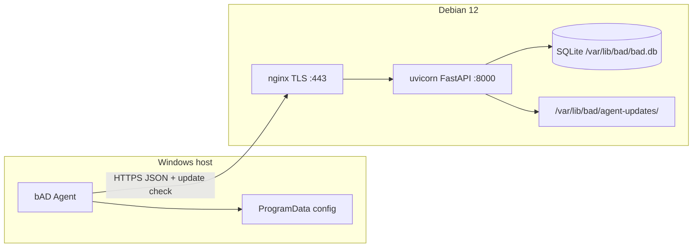
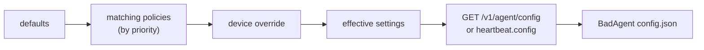

# Архитектура bAD

**blazerity Asset Discovery** — Windows-агент инвентаризации и on-prem сервер накопления снимков. Документ описывает фактическую архитектуру репозитория. Версия продукта: **0.9.0**.

## Компоненты

| Компонент | Путь | Роль |
|-----------|------|------|
| **Agent** | `agent/` | .NET 8 Worker Service (`BlazerityAssetDiscovery`): collect → enroll/heartbeat/inventory; self-update через сервер; CLI `service …` |
| **Server** | `server/` | FastAPI + SQLite: API `/v1/*`, web UI (session login + LDAP), зеркало MSI с GitHub Release, uvicorn на `127.0.0.1:8000` |
| **MSI** | `installer/msi/` | WiX: Program Files, служба, public properties `SERVERURL` / `ENROLLMENTTOKEN`; MajorUpgrade сохраняет ProgramData; полный uninstall чистит config/queue; optional Authenticode в `release-msi` |
| **Deploy** | `deploy/debian/` | one-line `install.sh` для Debian 12: venv, systemd, nginx TLS, ufw, `agent-updates/` |
| **GitHub Release** | `.github/workflows/release-msi.yml` | Источник `bad-agent-<ver>.msi` + `agent-release.json`; агенты к GitHub **не** ходят |



## Клиент (агент)

- Установка: MSI → `%ProgramFiles%\blazerity\bAD\`, служба auto-start под LocalSystem.
- Конфиг: `%ProgramData%\blazerity\bAD\config.json` (`server_url`, `enrollment_token` временно, `api_key`, `device_id`, интервалы, `update_*`, `remote_config_version`).
- Жизненный цикл: при старте enroll (если нет API key) → flush offline queue → check update → полный inventory → heartbeat (с подтягиванием remote config) → циклы по эффективным интервалам.
- Offline queue (0.9.0): при недоступном сервере inventory/heartbeat пишутся в `%ProgramData%\blazerity\bAD\queue\` и уходят с backoff (cap 64 / 14 дней); не молча теряются.
- Revoked API key (401/403): очистить `api_key`, сохранить `device_id`, запись в Application Event Log, не долбить API до re-enroll / reinstall.
- Remote config: сервер считает effective settings (defaults &lt; matching policies &lt; per-device override); агент применяет только safe knobs, сохраняет в `config.json`. Секреты / `server_url` / `device_id` с сервера не принимаются.
- `device_id`: MachineGuid (registry), fallback SMBIOS UUID.
- Collectors: WMI/CIM + .NET (+ Uninstall registry для software); сбор на `BelowNormal` + yields между WMI; сбой подсекции → `collector_errors[]` с `section` вроде `hardware.gpus` (остальной snapshot сохраняется).
- Секции `hardware` / `users` / `software` управляются knobs `collect_*` (disabled → поле `null`/omitted, без error spam).
- Hardware (когда `collect_hardware`): CPU, `ram_bytes`, disks/volumes **плюс** `serial_number`, `model`, `manufacturer`, `bios_version` (+ manufacturer/release), `battery` (charge/status/runtime), `monitors[]` (EDID/WMI, cap 8), `gpus[]` (cap 16), `ram_modules[]` (cap 32), `ram_memory_type`. Host: `ad_distinguished_name` / `ad_ou` (domain-joined, soft-fail workgroup). `minidumps` — метаданные `%SystemRoot%\Minidump\*.dmp` / `Memory.dmp` (имена/время/count, **без** тел файлов, cap 20). Поля additive внутри `schema_version=2`.
- HTTPS only; cleartext `http://` отклоняется (кроме явного `BAD_ALLOW_HTTP=1` для локальной разработки).
- `User-Agent: bad-agent/<semver>`; в payload поле `agent_version`.
- Heartbeat несёт лёгкий health: `last_inventory_ok` / `last_inventory_error`, `agent_uptime_seconds`, `system_drive_free_bytes` (DriveInfo, без тяжёлого WMI) → device `meta`.
- Local CLI reports (`bad` / `--html`): ASCII/HTML показывают serial/BIOS/battery/monitors/AD OU/minidumps при наличии; HTML визуально согласован с web panel (Win11/Fluent light).
- Крупные сбои enroll/update/revoke → Windows Application Event Log (source `bAD Agent`).
- Service CLI: `BadAgent.exe service status|start|stop|restart` (elevated); без подкоманды — host службы. См. [agents.md](agents.md).

## Удалённые настройки агента



- SQLite: `agent_policies` (name, priority, conditions JSON, settings JSON), `device_config_overrides` (per `device_id`).
- Условия: `hostname` / `domain` / `os_caption` / `tag` × `equals` / `contains` (AND внутри политики).
- Safe knobs: `inventory_interval_hours`, `heartbeat_interval_minutes`, `update_check_interval_hours`, `update_enabled`, `collect_hardware` (default true), `collect_users` (default true), `collect_software` (default false, opt-in).
- Software inventory (когда `collect_software`): лёгкий список name/version/publisher из Uninstall registry (64+32), cap 500.
- Web: `/settings/policies`; на странице устройства — effective + manual override.
- Теги устройства: JSON-массив `tags_json` на `devices`; правка в web / `PUT /v1/devices/{id}/tags`; фильтр списка `?tag=`.

## Поток обновления агента


1. **GitHub → MSI** — workflow `release-msi.yml` на тег `v*` / `workflow_dispatch`: `dotnet publish` win-x64 self-contained → WiX v5 (`dotnet tool wix`) → optional Authenticode (`CODE_SIGN_PFX_*`, иначе unsigned) → upload MSI + `agent-release.json` (`version`, `msi_name`, `sha256`). Linux CI MSI **не** собирает.
2. **Зеркало на сервере** — `BAD_GITHUB_REPO` (default `blazerity/bAD`), опционально `BAD_GITHUB_TOKEN`, интервал sync. Job / `POST /v1/admin/agent-update/sync` кладёт файлы в `BAD_AGENT_UPDATES_DIR` и метаданные в SQLite.
3. **Агент применяет** — check на старте и по расписанию → download → verify sha256 → `msiexec /i … /qn` → выход процесса; WiX `ServiceControl` / MajorUpgrade останавливает службу, меняет файлы, стартует снова. ProgramData сохраняется. Токены не логируются.

## Сервер

### API (`/v1`)

| Method | Path | Auth | Назначение |
|--------|------|------|------------|
| `GET` | `/v1/health` | нет | liveness + `version` |
| `POST` | `/v1/enroll` | enrollment Bearer | обмен на per-agent API key |
| `POST` | `/v1/heartbeat` | API key | `last_seen` + optional health → meta; piggyback `config` если `config_version` устарел |
| `POST` | `/v1/inventory` | API key | upsert снимка по `device_id` (host/network + optional hardware/users/software); diff → `device_events` |
| `GET` | `/v1/agent/config` | API key | effective settings только для своего устройства |
| `GET` | `/v1/devices` | admin Bearer | список (`?tag=&q=&archived=&page=&page_size=`) |
| `GET` | `/v1/devices/{device_id}` | admin Bearer | meta + tags + inventory + duplicates hint |
| `POST` | `/v1/devices/{id}/revoke` | admin | отозвать API key (далее 403) |
| `POST` | `/v1/devices/{id}/rotate-key` | admin | новый API key (plaintext один раз) |
| `POST` | `/v1/devices/{id}/archive` / `restore` | admin | скрыть/вернуть в списке |
| `DELETE` | `/v1/devices/{id}` | admin | hard-delete + связанные строки |
| `PUT` | `/v1/devices/{device_id}/tags` | admin Bearer | заменить теги устройства |
| `GET` | `/v1/events` | admin Bearer | события (`?device_id=&limit=&offset=`) |
| `GET` | `/v1/agent/update/check` | API key | `{update_available, version, sha256, url}` |
| `GET` | `/v1/agent/update/msi` | API key | байты зеркалированного MSI |
| `GET` | `/v1/admin/agent-update` | admin | статус зеркала |
| `POST` | `/v1/admin/agent-update/sync` | admin | sync с GitHub сейчас |
| `GET/POST/PUT/DELETE` | `/v1/admin/policies*` | admin | CRUD условных политик |
| `GET` | `/v1/admin/devices/{id}/config` | admin | effective + override + matched |
| `PUT/DELETE` | `/v1/admin/devices/{id}/config-override` | admin | ручной override |

- `schema_version` inventory: сервер принимает `1` и `2` (v2 добавляет optional `software`; hardware fields вроде `serial_number`/`gpus`/`ram_modules` — additive, без bump schema); неизвестные → `400`.
- Секреты сайта: enrollment и admin tokens (разные); в БД хранятся hash (argon2).
- Rate limit на `/v1/enroll` (sliding window).
- Count-retention: последние N снимков на устройство (`BAD_SNAPSHOT_RETENTION`, default 30).
- Day-retention (web): `retention_settings` — events (default 90d) и old snapshots (default 180d); фоновый prune раз в час; новейший снимок устройства не удаляется.

### TLS и nginx

- nginx слушает 443, TLS 1.2+, HSTS; proxy на `http://127.0.0.1:8000`.
- uvicorn не публикует внешний интерфейс.
- Cert/key: пути при install → symlink в `/etc/bad/tls/`.

### Web UI и аутентификация

Визуальный язык (с **0.8.0**, актуально в **0.9.0**): светлая оболочка в духе Windows 11 / Fluent — Segoe UI Variable, слоистые полупрозрачные поверхности, радиусы 4px (controls) / 8px (surfaces), акцент Fluent blue (`#0067C0`), UI copy на русском, stroke-иконки секций (без emoji). Стили: `server/bad_server/static/style.css` + `favicon.svg`/`favicon.ico`; локальный HTML-отчёт (`HtmlReportWriter`) — та же семья токенов/иконок. Иконка агента: `agent/assets/bad.ico` (`ApplicationIcon` + WiX `ARPPRODUCTICON`).

| Path | Назначение |
|------|------------|
| `/`, `/overview` | обзор: totals, версии агента, последние hardware events |
| `/login` | username/password (local, затем LDAP если включён) |
| `/logout` | сброс cookie сессии |
| `/devices`, `/devices/{id}` | список (поиск/архив/страницы/CSV); карточка — revoke/rotate, архив, delete, дубли, tags, override, hardware summary |
| `/devices/export.csv` | CSV устройств с учётом фильтров |
| `/events` | события inventory + пагинация |
| `/settings` | редирект в оболочку «Параметры» (левый nav) |
| `/settings/ldap` | LDAP + группа доступа AD |
| `/settings/mail` | SMTP + получатели + toggles уведомлений |
| `/settings/retention` | сроки хранения events/inventory |
| `/settings/backups` | статус ежедневного SQLite backup + ручной запуск |
| `/settings/policies` | CRUD политик remote config |
| `/settings/updates` | статус зеркала MSI + sync |
| `/account/password` | смена пароля локального пользователя |

**Локальные пользователи**

- Таблица `local_users`; пароли — argon2.
- Первый boot / пустая таблица: создаётся `admin` / `admin` с флагом `must_change_password` (баннер + редирект на смену пароля).
- Работает **без** настроенного LDAP.

**LDAP (опционально)**

- Настройки в `ldap_settings` (одна строка): host, port, use_ssl / start_tls, bind DN, encrypted bind password, search base, filter template (`{username}`), display name attr, default role, **`allowed_group`** (sAMAccountName или DN группы AD; пусто = без ограничения).
- Bind password шифруется Fernet-ключом из `site_secrets.data_key`; в форме после save — placeholder «unchanged», plaintext не отдаётся.
- Логин: сначала local match (break-glass); иначе, если LDAP enabled — search + user bind через `ldap3`, затем проверка членства в `allowed_group` (в т.ч. nested via matching rule). Иначе — отказ с русской ошибкой.
- Роль LDAP-пользователей: `operator` или `admin` — поле default role.

**Почта (SMTP)**

- Таблица `smtp_settings`: host/port/TLS, user, encrypted password, From, To (comma-separated), `notify_json` toggles.
- Defaults ON: hardware (RAM/CPU/disks/serial/model), stale, enroll. Defaults OFF: hostname, domain. Без webhooks.
- Soft-fail: ошибки SMTP только в лог, enroll/inventory не ломаются.
- Stale-алерты — фоновый цикл (~5 мин) с флагом `meta.stale_notified_at`.

**Резервные копии SQLite**

- Каталог `BAD_BACKUP_DIR` (default `/var/lib/bad/backups`).
- Ежедневно файл `bad-YYYY-MM-DD.db` (sqlite3 backup API); хранятся сегодня + вчера.
- Restore вручную: остановить сервис, скопировать файл на `BAD_DB_PATH`.

**Сессия**

- Подписанный cookie `bad_session` (itsdangerous, 12h); секрет из `BAD_SESSION_SECRET` или `site_secrets.session_secret`.

- На `/devices` дополнительно показывается mirrored agent MSI version (из `agent_update`).
- Silence/health: badge **OK** / **stale** если `last_seen_at` старше `BAD_DEVICE_STALE_AFTER_SECONDS` (default 3600 ≈ 1h; можно выставить ~2× heartbeat). На карточке устройства — last seen + опциональный health snippet из `meta` (`health` / `last_health`, если агент их пришлёт).

### События inventory

При каждом upsert сравнивается предыдущий и новый snapshot. Пишутся осмысленные изменения: hostname/domain, logged-on / last_interactive, диск добавлен/удалён, сильное падение free space тома, смена IPv4 NIC, **CPU / RAM bytes / RAM modules / serial / model / manufacturer**. Таблица `device_events`. Первый снимок событий не создаёт.

### Данные

- SQLite: `/var/lib/bad/bad.db` (prod), владелец `bad:bad`, WAL.
- Таблицы: `devices` (+ `tags_json`, `revoked`, `archived`), `inventory_snapshots`, `device_events`, `site_secrets`, `local_users`, `ldap_settings` (+ `allowed_group`), `retention_settings`, `smtp_settings`, `agent_update`, `agent_policies`, `device_config_overrides`.
- Каталог MSI: `/var/lib/bad/agent-updates/`; бэкапы: `/var/lib/bad/backups/`.

## Enrollment и inventory

1. Оператор задаёт site enrollment token (install script → `/etc/bad/site.env`).
2. MSI/config передаёт `SERVERURL` + `ENROLLMENTTOKEN`.
3. Агент `POST /v1/enroll` → получает `api_key`, сохраняет в ProgramData, затирает enrollment token.
4. Повторные запуски используют API key; upsert по стабильному `device_id`.

## Deploy

```bash
BAD_DOMAIN=… BAD_TLS_CERT=… BAD_TLS_KEY=… sudo -E bash deploy/debian/install.sh
```

Скрипт: пакеты, user `bad`, `/opt/bad` + venv, `bad-api.service`, nginx site, ufw 22/80/443, `agent-updates/`, печать enrollment/admin tokens один раз. Web UI: `admin`/`admin` (сменить сразу); admin Bearer — для API. В `site.env` также `BAD_GITHUB_REPO` и параметры sync.

Артефакты релиза агента: `bad-agent-<semver>.msi`, `agent-release.json` (через GitHub Release). Как вырезать релиз: [guideline.md](guideline.md).

## Вне scope v1

macOS/Linux агенты (полноценный collect), расширенный software/патчи, RBAC/SSO, HA SQLite, push-команды на агент, Let’s Encrypt как основной путь, полноценный product dashboard. Прямой доступ агентов к GitHub — вне модели (только server mirror).
