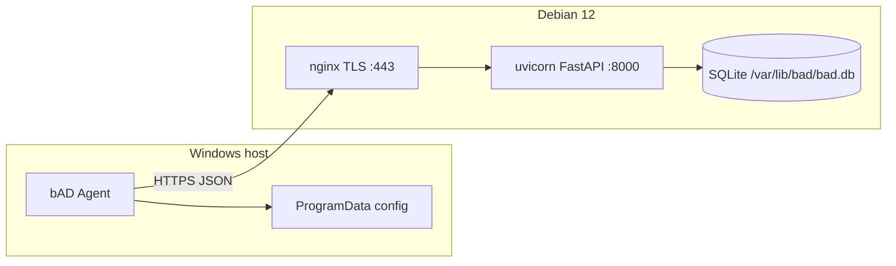

# Архитектура bAD

**blazerity Asset Discovery** — Windows-агент инвентаризации и on-prem сервер накопления снимков. Документ описывает фактическую архитектуру репозитория в согласовании с [architecture-plan.md](architecture-plan.md).

## Компоненты

| Компонент | Путь | Роль |
|-----------|------|------|
| **Agent** | `agent/` | .NET 8 Worker Service (`BlazerityAssetDiscovery`): collect → enroll/heartbeat/inventory по HTTPS |
| **Server** | `server/` | FastAPI + SQLite: API `/v1/*`, read-only web UI, uvicorn на `127.0.0.1:8000` |
| **MSI** | `installer/msi/` | WiX: Program Files, служба, public properties `SERVERURL` / `ENROLLMENTTOKEN` |
| **Deploy** | `deploy/debian/` | one-line `install.sh` для Debian 12: venv, systemd, nginx TLS, ufw |



## Клиент (агент)

- Установка: MSI → `%ProgramFiles%\blazerity\bAD\`, служба auto-start под LocalSystem.
- Конфиг: `%ProgramData%\blazerity\bAD\config.json` (`server_url`, `enrollment_token` временно, `api_key`, `device_id`, интервалы).
- Жизненный цикл: при старте enroll (если нет API key) → полный inventory → heartbeat каждые 15 мин, inventory каждые 6 ч.
- `device_id`: MachineGuid (registry), fallback SMBIOS UUID.
- Collectors: WMI/CIM + .NET; сбой секции → `null` + запись в `collector_errors[]`.
- HTTPS only; cleartext `http://` отклоняется (кроме явного `BAD_ALLOW_HTTP=1` для локальной разработки).
- `User-Agent: bad-agent/<semver>`; в payload поле `agent_version`.

## Сервер

### API (`/v1`)

| Method | Path | Auth | Назначение |
|--------|------|------|------------|
| `GET` | `/v1/health` | нет | liveness + `version` |
| `POST` | `/v1/enroll` | enrollment Bearer | обмен на per-agent API key |
| `POST` | `/v1/heartbeat` | API key | `last_seen`, `agent_version` |
| `POST` | `/v1/inventory` | API key | upsert снимка по `device_id` |
| `GET` | `/v1/devices` | admin Bearer | список устройств |
| `GET` | `/v1/devices/{device_id}` | admin Bearer | meta + последний inventory |

- `schema_version` сейчас `1`; неизвестные версии → `400`.
- Секреты сайта: enrollment и admin tokens (разные); в БД хранятся hash (argon2).
- Rate limit на `/v1/enroll` (sliding window).
- Retention: последние 30 снимков на устройство.

### TLS и nginx

- nginx слушает 443, TLS 1.2+, HSTS; proxy на `http://127.0.0.1:8000`.
- uvicorn не публикует внешний интерфейс.
- Cert/key: пути при install → symlink в `/etc/bad/tls/`.

### Web UI

- Тот же origin: `/login`, `/devices`, `/devices/{id}`.
- Read-only: список и карточка с JSON последнего inventory.
- Auth: admin token → cookie `bad_admin_token` (httponly).
- Версия сервера в footer шаблона.

### Данные

- SQLite: `/var/lib/bad/bad.db` (prod), владелец `bad:bad`, WAL.
- Таблицы: `devices`, `inventory_snapshots`, `site_secrets`.
- Миграции: `server/bad_server/migrations/`.

## Enrollment и inventory

1. Оператор задаёт site enrollment token (install script → `/etc/bad/site.env`).
2. MSI/config передаёт `SERVERURL` + `ENROLLMENTTOKEN`.
3. Агент `POST /v1/enroll` → получает `api_key`, сохраняет в ProgramData, затирает enrollment token.
4. Повторные запуски используют API key; upsert по стабильному `device_id`.

## Deploy

```bash
BAD_DOMAIN=… BAD_TLS_CERT=… BAD_TLS_KEY=… sudo -E bash deploy/debian/install.sh
```

Скрипт: пакеты, user `bad`, `/opt/bad` + venv, `bad-api.service`, nginx site, ufw 22/80/443, печать tokens один раз.

Артефакты релиза (имена): `bad-agent-<semver>.msi`, `bad-server-<semver>.tar.gz`, `install.sh`.

## Вне scope v1

macOS/Linux агенты, software inventory, RBAC/SSO, HA SQLite, push-команды на агент, Let’s Encrypt как основной путь, полноценный product dashboard.
